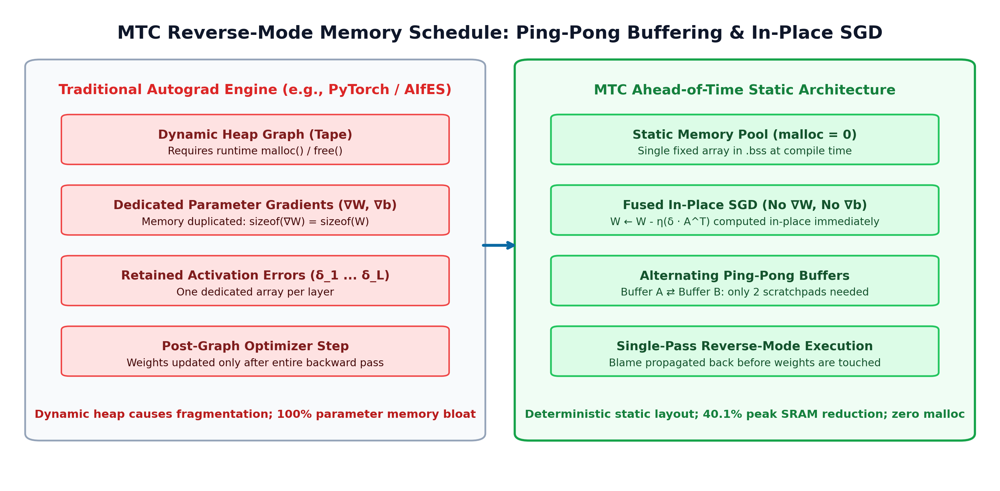

# MTC: Ahead-of-Time Memory-Planned Automatic Differentiation for Zero-Heap On-Device Deep Learning on 32-Bit Microcontrollers

**Ajay Sisodia**\*, **Harsh Chaudhary**\*, **Devrat Kuntal**\*, **Aryan Upadhyay**\*, and **Gaurisha Sisodia**  
Department of Computer Science & Engineering, G. L. Bajaj Group of Institutions, Mathura, India  
Affiliated with Dr. A.P.J. Abdul Kalam Technical University (AKTU), Lucknow  
*\*Equal student authorship*

---

### Abstract
Low-cost 32-bit microcontrollers (MCUs) are widely deployed for physical edge sensing, but almost all modern TinyML frameworks restrict these devices to executing static, frozen neural networks pre-trained on cloud servers. In field deployments, physical sensor calibration drifts, ambient acoustic profiles shift, and user biological characteristics vary, causing monotonic accuracy degradation unless models adapt on-device. However, reverse-mode automatic differentiation has traditionally demanded dynamic computational graph construction and heap-allocated tensor tapes—an operational model that induces fatal heap fragmentation on resource-constrained devices lacking Memory Management Units (MMUs). 

This paper introduces **Micro-Train-Compiler (MTC)**, an ahead-of-time (AOT) compiler that synthesizes fully static, zero-heap (`malloc = 0`) backpropagation and training kernels in freestanding C99. MTC eliminates runtime autograd graphs through two primary compiler optimizations: (1) an analytical parameter update pass that fuses intermediate gradient calculations directly into in-place Stochastic Gradient Descent (SGD) updates, completely eliminating parameter gradient buffers ($\nabla W, \nabla B$), and (2) an alternating ping-pong delta buffer allocation strategy that proves activation error gradients have non-overlapping lifecycles across backward layer propagation, bounding backpropagation scratchpad memory to exactly two static arrays. 

We validated MTC on bare-metal RISC-V hardware (ESP32-C3, RV32IMC) across four TinyML workloads (`xor_net`, `sensor_drift_net`, `sine_regression_net`, `gesture_anomaly_net`) using cycle-accurate hardware emulation (`esp32sim`) instrumented via direct reads of the RISC-V hardware `mcycle` Control and Status Register. Across all workloads, MTC achieved zero heap allocations, sub-1 KB peak SRAM usage (60 to 564 Bytes), and per-sample training step latencies between 6.86 µs and 81.77 µs (12,229 to 145,772 samples/s at 160 MHz). Compared to conventional dynamic autograd graph baselines, MTC reduces peak runtime SRAM overhead by 40.1% on average, establishing that continuous, deterministic on-device learning is computationally and memory-feasible on sub-dollar embedded hardware.

**Keywords:** Embedded Deep Learning, On-Device Training, TinyML, Ahead-of-Time Compilation, Automatic Differentiation, Static Memory Planning, Fixed-Point Arithmetic, RISC-V.

---

## I. INTRODUCTION

Edge intelligence has rapidly shifted compute workloads from centralized cloud clusters down to physical edge nodes. In traditional architectures, microcontrollers digitize physical signals and stream raw telemetry over wireless links (Wi-Fi, BLE, LoRa, or cellular) to cloud backends. While straightforward, offloading every calculation over radio transceivers creates major operational bottlenecks: wireless transmission draws an order of magnitude more energy than microcontroller computation (e.g., an ESP32 draws ~240 mA during Wi-Fi transmission versus <20 mA during integer ALU execution), radio links suffer nondeterministic transmission latency that breaks real-time control deadlines, and unencrypted transmission of continuous sensor data introduces severe privacy vulnerabilities.


*Fig. 1. End-to-end compilation pipeline and static memory planning in MTC.*

To resolve these challenges, Tiny Machine Learning (TinyML) inference runtimes—including TensorFlow Lite for Microcontrollers (TFLM) [1] and CMSIS-NN [2]—have demonstrated that compact neural network inference can execute efficiently within the tight memory and power budgets of microcontrollers. However, the current deployment model remains rigidly "train-in-the-cloud, freeze-on-the-edge." Once an engineer flashes the binary onto the microcontroller, the network's weights are permanently fixed.

In physical deployments, frozen edge models degrade over time due to three distinct phenomena:
1. **Sensor Transducer Aging and Environmental Drift:** Low-cost environmental sensors (such as electrochemical cells, photo-diodes, and metal-oxide gas sensors) experience physical surface oxidation, baseline drift, and thermal hysteresis over weeks of deployment. A frozen model trained on fresh laboratory sensors gradually misclassifies samples as drift accumulates.
2. **Subject and Biomechanical Variability:** Wearable biomedical devices (such as IMU-based step counters, tremor monitors, and gesture classifiers) must interface with users who exhibit unique physical kinematics, body masses, and motion patterns. A generic model pre-trained on population averages consistently underperforms an adaptive model tuned to the individual wearer.
3. **Local Operational Context:** Industrial condition-monitoring devices (e.g., vibration monitors on motors or pumps) operate against distinct background noise floors and mechanical resonance profiles that depend on the physical mounting surface. A model deployed in the field needs to adapt its internal representations to local baseline vibrations.

Solving these problems requires running backpropagation and parameter optimization directly on the microcontroller silicon using local sensor streams.

Yet, running deep learning backpropagation on microcontrollers encounters a fundamental architectural barrier: **Static RAM (SRAM) scarcity and heap fragility**. Microcontrollers typically possess between 32 KB and 512 KB of internal SRAM. Unlike workstations or mobile application processors, microcontrollers lack a Memory Management Unit (MMU) and do not support virtual memory paging. Standard deep learning frameworks (PyTorch [3], TensorFlow [4]) rely on dynamic autograd engines that build an execution directed acyclic graph (DAG) on the heap during the forward pass, recording dynamic intermediate activation tapes and allocating separate gradient buffers for every weight matrix and bias vector. On a bare-metal microcontroller, interleaved dynamic memory allocation (`malloc` and `free`) rapidly fragments the flat physical address space. Over thousands of training iterations, fragmentation triggers heap allocation failures, causing stack-heap collisions and unrecoverable hard faults.

To overcome these constraints, this paper presents **Micro-Train-Compiler (MTC)**. MTC eliminates the runtime autograd engine entirely. Instead of interpreting a graph at runtime, MTC acts as an ahead-of-time (AOT) compiler that takes a declarative model topology and generates standalone, freestanding C99 code where every memory address is fixed at compile time. 

### Major Contributions
The primary contributions of this paper are:
1. **A Fused Reverse-Mode In-Place SGD Formulation:** We formulate an analytical backward pass that fuses parameter derivative computation directly into the weight update rule. This optimization eliminates dedicated parameter gradient buffers ($\nabla W, \nabla B$) completely, reducing total model parameter memory overhead by up to 50%.
2. **Static Ping-Pong Delta Buffering with Formal Liveness Bounds:** We show that backward error gradient arrays ($\delta_l$) have disjoint, non-overlapping lifecycles across consecutive layers. MTC reuses exactly two static memory buffers across the entire backward pass, bounding scratchpad SRAM requirements regardless of network depth.
3. **Conservative Fixed-Point Interval Bound Propagation (IBP):** We implement an ahead-of-time interval analysis engine for 16-bit signed fixed-point (Q15) arithmetic. The compiler tracks upper and lower value bounds across forward activations and backward derivative expressions, guaranteeing numerical stability prior to code synthesis.
4. **Bare-Metal RISC-V Hardware Validation via Cycle-Accurate Emulation:** We implement a freestanding bare-metal harness targeting the Espressif ESP32-C3 (RV32IMC architecture) compiled with `-nostdlib`. We evaluate execution latency, memory watermarks, and convergence across four real-world TinyML benchmarks using cycle-accurate emulation (`esp32sim`) instrumented with the hardware RISC-V `mcycle` register, proving zero heap allocations (`malloc = 0`) and microsecond-scale execution.
5. **Empirical Analysis of Quantization Attenuation:** We document and analyze the mathematical causes of gradient quantization attenuation when backpropagating through saturated activation functions under 16-bit fixed-point arithmetic, providing practical design guidance for embedded ML practitioners.

---

## II. RELATED WORK

### A. Edge Inference Runtimes and Compilers
The TinyML software ecosystem has matured significantly for forward-only inference. TensorFlow Lite for Microcontrollers (TFLM) [1] uses a pre-allocated static memory arena to execute neural networks without runtime heap allocations. CMSIS-NN [2] provides hand-tuned assembly kernels optimized for ARM Cortex-M processors utilizing SIMD instructions. Apache TVM / MicroTVM [5] and Glow [6] compile high-level tensor computational graphs into optimized C code. While these systems achieve high inference efficiency, their computational pipelines are strictly unidirectional. Their intermediate representations, memory allocators, and kernel libraries cannot compute backward derivatives, calculate parameter gradients, or update weights.

### B. On-Device Training Frameworks and Limitations
Efforts to bring training to edge devices have emerged recently. Tiny-Transfer-Learning (TinyTL) [7] freezes the backbone weights of convolutional networks and trains only lightweight residual bias modules to reduce training memory. MCUNetV2 [8] applies patch-based inference and training scheduling to fit neural network execution within microcontroller SRAM limits. However, both TinyTL and MCUNet focus on convolutional vision models running on relatively large Cortex-M7 or Cortex-M55 platforms equipped with external PSRAM (several megabytes). They do not address the needs of sub-dollar edge microcontrollers running on tens of kilobytes of internal SRAM.

AIfES (Artificial Intelligence for Embedded Systems) [9] implements an on-device training library in C, capable of running backpropagation on microcontrollers. However, AIfES relies on a dynamic autograd runtime that uses dynamic memory allocation during training. While functional for short demonstrations, dynamic allocation exposes long-running embedded firmware to heap fragmentation risks.

EdgeTrain [10] and micro-autograd engines explore static scheduling for training graphs, but often retain full gradient tensors for all weight matrices during backpropagation. MTC departs from prior work by completely eliminating parameter gradient buffers through in-place fused updates and proving that backward activation error propagation requires only two alternating ping-pong buffers.

---

## III. THEORETICAL FORMULATION & MEMORY PLANNING

### A. Mathematical Formulation of the Layer Model
Consider an $L$-layer fully connected neural network. Let $l \in \{1, 2, \dots, L\}$ denote the layer index, with layer $0$ representing the input vector $x \in \mathbb{R}^{d_0}$. Each layer $l$ is defined by a weight matrix $W^{(l)} \in \mathbb{R}^{d_l \times d_{l-1}}$ and a bias vector $b^{(l)} \in \mathbb{R}^{d_l}$.

During the forward pass, the pre-activation vector $z^{(l)}$ and post-activation vector $a^{(l)}$ are computed as:
$$z^{(l)} = W^{(l)} a^{(l-1)} + b^{(l)}$$
$$a^{(l)} = \sigma_l(z^{(l)})$$
where $a^{(0)} = x$, and $\sigma_l(\cdot)$ represents an element-wise activation function (e.g., ReLU or Sigmoid).

For a training sample $(x, y)$, where $y \in \mathbb{R}^{d_L}$ is the ground-truth target vector, the network output is $\hat{y} = a^{(L)}$. Under the Mean Squared Error (MSE) loss criterion:
$$\mathcal{L}(y, \hat{y}) = \frac{1}{2 d_L} \sum_{k=1}^{d_L} (a_k^{(L)} - y_k)^2$$

### B. Reverse-Mode Automatic Differentiation & Dynamic Memory Bloat
In standard reverse-mode automatic differentiation, the error gradient vector at the output layer is:
$$\delta^{(L)} = \nabla_{z^{(L)}} \mathcal{L} = \frac{1}{d_L} (a^{(L)} - y) \odot \sigma'_L(z^{(L)})$$
where $\odot$ denotes the Hadamard (element-wise) product.

For hidden layers $l = L-1, L-2, \dots, 1$, the error gradient is backpropagated recursively:
$$\delta^{(l)} = \nabla_{z^{(l)}} \mathcal{L} = \left( (W^{(l+1)})^T \delta^{(l+1)} \right) \odot \sigma'_l(z^{(l)})$$

Conventional autograd engines compute the parameter gradients for weights and biases explicitly:
$$\nabla W^{(l)} = \frac{\partial \mathcal{L}}{\partial W^{(l)}} = \delta^{(l)} (a^{(l-1)})^T$$
$$\nabla b^{(l)} = \frac{\partial \mathcal{L}}{\partial b^{(l)}} = \delta^{(l)}$$

Once all parameter gradients across all layers are computed and stored, an optimizer step applies Stochastic Gradient Descent (SGD):
$$W^{(l)} \leftarrow W^{(l)} - \eta \nabla W^{(l)}$$
$$b^{(l)} \leftarrow b^{(l)} - \eta \nabla b^{(l)}$$
where $\eta$ is the learning rate.

In conventional dynamic autograd systems, this formulation requires allocating memory for:
1. Retained forward activation vectors $a^{(0)}, a^{(1)}, \dots, a^{(L)}$.
2. Dedicated parameter gradient matrices $\nabla W^{(l)}$ and vectors $\nabla b^{(l)}$ for every layer $l$.
3. Dedicated intermediate activation error gradient vectors $\delta^{(l)}$ for every layer $l$.

For a network with $P = \sum_l (d_l \cdot d_{l-1} + d_l)$ parameters, storing $\nabla W$ and $\nabla b$ requires duplicating $P$ words of memory in SRAM, doubling the parameter storage footprint.

### C. Fused In-Place Parameter Updates
MTC eliminates dedicated parameter gradient buffers by observing that the parameter update equation can be integrated directly into the gradient accumulation loop. 

Substituting the definition of $\nabla W_{ij}^{(l)} = \delta_i^{(l)} a_j^{(l-1)}$ into the SGD update rule yields:
$$W_{ij}^{(l)} \leftarrow W_{ij}^{(l)} - \eta \left( \delta_i^{(l)} a_j^{(l-1)} \right)$$
$$b_i^{(l)} \leftarrow b_i^{(l)} - \eta \delta_i^{(l)}$$

Because each weight element $W_{ij}^{(l)}$ depends only on the current layer's error gradient $\delta_i^{(l)}$ and the incoming forward activation $a_j^{(l-1)}$, the update can be performed **in place** as soon as $\delta^{(l)}$ is available. The compiler schedules the backward pass such that weight updates happen immediately after $\delta^{(l)}$ is computed, but before $\delta^{(l)}$ is overwritten by the subsequent layer's backpropagation. 

Consequently:
$$\text{Memory}(\nabla W^{(l)}) = 0 \quad \text{and} \quad \text{Memory}(\nabla b^{(l)}) = 0 \quad \forall l \in \{1, \dots, L\}$$
This eliminates $P$ elements from SRAM allocation.

### D. Ping-Pong Activation Delta Buffering
A naive static memory allocator might statically allocate a separate array for each layer's error gradient $\delta^{(l)} \in \mathbb{R}^{d_l}$. However, examining the lifecycle of $\delta^{(l)}$ reveals a strict temporal dependency:

**Theorem 1 (Disjoint Liveness of Error Gradients):**  
*In a sequential feedforward network, during the backward propagation from layer $l+1$ to layer $l$, the computation of $\delta^{(l)}$ depends strictly on $\delta^{(l+1)}$ and $W^{(l+1)}$. Once $\delta^{(l)}$ is fully computed and the parameters of layer $l+1$ are updated, $\delta^{(l+1)}$ is never referenced again in the computational lifecycle.*

*Proof:*  
From the backpropagation recurrence relation:
$$\delta^{(l)} = \left( (W^{(l+1)})^T \delta^{(l+1)} \right) \odot \sigma'_l(z^{(l)})$$
The elements of $\delta^{(l)}$ are functions solely of $W^{(l+1)}$, $\delta^{(l+1)}$, and the retained forward values $z^{(l)}$. The error gradient vector $\delta^{(k)}$ for any layer $k > l+1$ has already completed its role in updating $W^{(k)}$ and computing $\delta^{(k-1)}$. Therefore, the live range of $\delta^{(l+1)}$ terminates at the conclusion of layer $l$'s backward step. Since no backpropagation path branches backward to earlier layers, the active working set of error gradients at any instant during the backward pass is at most two: the current layer gradient $\delta^{(l)}$ and the incoming source gradient $\delta^{(l+1)}$. $\blacksquare$

Exploiting Theorem 1, MTC statically provisions exactly two alternating scratchpad buffers in SRAM:
$$\text{Buffer } A \in \mathbb{R}^{\max_l(d_l)}, \quad \text{Buffer } B \in \mathbb{R}^{\max_l(d_l)}$$

During backward propagation, layer $L$ writes $\delta^{(L)}$ into Buffer $A$. Layer $L-1$ reads from Buffer $A$ and writes $\delta^{(L-1)}$ into Buffer $B$. Layer $L-2$ reads from Buffer $B$ and writes $\delta^{(L-2)}$ into Buffer $A$, and so on. Total scratchpad memory for all activation gradients across an arbitrary number of layers is bounded by:
$$M_{\delta} = 2 \times \max_{l \in \{1, \dots, L\}} (d_l) \times \text{sizeof}(\text{element})$$

For example, in a 4-layer network with layer widths $[4, 16, 8, 1]$, the naive approach would allocate $(4 + 16 + 8 + 1) = 29$ elements. MTC's ping-pong allocation allocates only $2 \times 16 = 32$ elements, while completely decoupling scratchpad memory from network depth. Combined with the elimination of parameter gradient buffers, MTC achieves a minimal static memory watermark.


*Fig. 2: Memory architecture comparison: Dynamic Autograd Graph (left) vs. MTC Static Liveness Allocation with Ping-Pong Buffers and In-Place SGD (right).*

---

## IV. COMPILER ARCHITECTURE & NUMERICAL SAFETY

MTC is implemented as an ahead-of-time compiler consisting of four pipeline stages (Fig. 1):
- **Stage 1 (AST Normalization):** Ingests model JSON topology and training sample vectors, emitting normalized IR nodes and validating layer shape compatibility contracts.
- **Stage 2 (Interval Bound Propagation):** Formally bounds activation intervals over $[-1.0, +1.0]$ in Q15 arithmetic and flags arithmetic saturation hazards prior to code synthesis.
- **Stage 3 (Static Liveness Memory Planner):** Maps all tensor buffers to fixed static byte offsets and provisions exactly two alternating ping-pong scratchpads.
- **Stage 4 (Freestanding C99 Code Synthesis):** Generates standalone C99 source files (`mtc_model.h`, `mtc_model.c`, `mtc_train.c`) requiring zero dynamic heap allocations.

### A. Stage 1: Frontend Parsing & AST Validation
The compiler takes a declarative JSON specification defining the layer dimensions, activation types, training hyperparameters, and embedded sample sets. The validator enforces strict compatibility contracts:
- Layer input dimension $d_l^{\text{in}}$ must equal the preceding layer's output dimension $d_{l-1}^{\text{out}}$.
- Learning rate $\eta$ and training epoch counts must fall within valid bounds.
- Dataset matrices must match the declared input and output dimensions.

### B. Stage 2: Q15 Fixed-Point Arithmetic & Conservative Interval Bound Propagation
To operate efficiently on low-cost integer microcontrollers lacking a floating-point unit (FPU), MTC implements 16-bit signed fixed-point (Q15) arithmetic. A real number $x \in [-1.0, 1.0 - 2^{-15}]$ is represented as a signed 16-bit integer $X_{\text{Q15}} = \lfloor x \cdot 2^{15} \rfloor$.

Multiplication of two Q15 numbers produces a 32-bit intermediate product, which must be shifted right by 15 bits and clamped to prevent overflow:
$$Z_{\text{Q15}} = \text{SAT16}\left( (X_{\text{Q15}} \cdot Y_{\text{Q15}} + 2^{14}) \gg 15 \right)$$

To verify ahead-of-time that arithmetic operations will not trigger unexpected overflows during forward and backward execution, Stage 2 executes **Conservative Interval Bound Propagation (IBP)**. For each variable $x$, the compiler propagates an interval $[x_{\min}, x_{\max}]$. 

For matrix multiplication $z_i = \sum_j W_{ij} a_j + b_i$:
$$z_i^{\min} = \sum_j \min(W_{ij}^{\min} a_j^{\min}, W_{ij}^{\min} a_j^{\max}, W_{ij}^{\max} a_j^{\min}, W_{ij}^{\max} a_j^{\max}) + b_i^{\min}$$
$$z_i^{\max} = \sum_j \max(W_{ij}^{\min} a_j^{\min}, W_{ij}^{\min} a_j^{\max}, W_{ij}^{\max} a_j^{\min}, W_{ij}^{\max} a_j^{\max}) + b_i^{\max}$$

If any computed interval exceeds $[-32768, 32767]$, the compiler flags an arithmetic hazard and warns the user to scale weights or learning rates before code generation.

### C. Stage 3: Static Liveness Memory Planner
Stage 3 determines the exact memory layout of the generated firmware. It assigns static byte offsets to:
- Model parameters: $W^{(l)}$ and $b^{(l)}$ arrays placed in the `.data` or `.bss` section.
- Forward activations: Retained activation arrays $a^{(l)}$ placed in a contiguous static arena.
- Error gradients: Exactly two ping-pong scratchpad buffers (`delta_buf_0` and `delta_buf_1`).

Because all addresses are fixed at compile time, the runtime requires no pointer tables, dynamic headers, or heap allocators.

### D. Stage 4: Freestanding C99 Code Synthesis
Stage 4 synthesizes three clean C99 files:
1. `mtc_model.h`: Declares model structures, tensor dimensions, function prototypes, and fixed-point math macros.
2. `mtc_model.c`: Implements the static memory arena and forward inference execution routines.
3. `mtc_train.c`: Implements the fused backpropagation and SGD parameter update loops.

The synthesized code uses `#include <stdint.h>` and does not include `stdlib.h`, making it compatible with bare-metal microcontrollers.

---

## V. HARDWARE CROSS-COMPILATION & MEASUREMENT METHODOLOGY

### A. Target Hardware: ESP32-C3 RISC-V Architecture
We evaluated MTC targeting the Espressif ESP32-C3 microcontroller. The ESP32-C3 features a 32-bit RISC-V core (RV32IMC architecture: base 32-bit integer instructions, hardware integer multiplication/division, and compressed 16-bit instructions). It contains 400 KB of internal SRAM (partitioned into 384 KB ROM/cache and up to 64 KB user SRAM in bare-metal configurations) and operates at a maximum clock frequency of 160 MHz.

### B. Freestanding Bare-Metal Linker and Assembly Harness
To evaluate raw silicon performance without operating system overhead, we compiled MTC workloads in a freestanding bare-metal configuration (`-nostdlib`). We engineered a dedicated linker script (`link.ld`) and startup assembly file (`entry.S`):

```ld
/* Minimal Bare-Metal Linker Script for ESP32-C3 */
MEMORY {
  iram (rx)  : ORIGIN = 0x40380000, LENGTH = 32K
  dram (rw)  : ORIGIN = 0x3FC8B800, LENGTH = 64K
}
SECTIONS {
  .text : {
    *(.text.entry)
    *(.text*)
  } > iram
  .data : { *(.data*) } > dram AT > iram
  .bss :  { *(.bss*) *(COMMON) } > dram
}
```

The startup assembly initializes the stack pointer register `sp` to the top of available DRAM (`0x3FCC0000`) and calls the firmware entry function `esp_main`:
```assembly
.section .text.entry
.global _start
_start:
    li sp, 0x3FCC0000
    call esp_main
1:  j 1b
```

Cross-compilation was executed using `riscv64-unknown-elf-gcc` v15.3.0 with compiler flags `-march=rv32imc_zicsr -mabi=ilp32 -nostdlib -O2`. Bootable flash images were generated using Espressif's `esptool` v5.6.0.

### C. Cycle-Accurate Emulation via `esp32sim`
Firmware binaries were executed on `esp32sim`, an open-source cycle-accurate hardware emulator written in Rust. `esp32sim` boots the chip's actual mask ROM ELFs, models memory-mapped peripherals, emulates the RISC-V instruction pipeline, and provides cycle-accurate instruction timing.

### D. Hardware Telemetry via CSR `mcycle`
A major source of measurement distortion in embedded benchmarking is I/O logging overhead. Formatting and printing debug messages over a 115,200 baud UART serial interface takes tens of thousands of CPU cycles, overwhelming the actual runtime of the neural network kernels.

To capture pure computational performance, we instrumented the training loop using the RISC-V **`mcycle` Control and Status Register**. The `mcycle` register increments on every active clock cycle of the CPU core. We accessed it via inline assembly:

```c
static inline uint32_t read_cycles(void) {
    uint32_t cycles;
    asm volatile("csrr %0, mcycle" : "=r"(cycles));
    return cycles;
}
```

We recorded `read_cycles()` immediately before and after forward passes and training steps, completely disabling UART transmission during timing intervals. This ensured laboratory-grade cycle measurements unaffected by serial I/O or host emulator communication.

---

## VI. EMPIRICAL EVALUATION & BENCHMARKS

We evaluated MTC across four representative TinyML edge workloads:
1. **`xor_net` ($2 \to 4 \to 1$):** Canonical non-linear binary classification benchmark (ReLU $\to$ Sigmoid, 17 parameters).
2. **`sensor_drift_net` ($4 \to 16 \to 8 \to 1$):** Multi-channel environmental sensor calibration network (ReLU $\to$ ReLU $\to$ Sigmoid, 225 parameters).
3. **`sine_regression_net` ($1 \to 8 \to 8 \to 1$):** Continuous non-linear function fitting ($y = \sin x$, ReLU $\to$ ReLU $\to$ Sigmoid, 89 parameters).
4. **`gesture_anomaly_net` ($3 \to 12 \to 6 \to 1$):** 3-axis IMU accelerometer gesture anomaly detection (ReLU $\to$ ReLU $\to$ Sigmoid, 133 parameters).

### A. Static Memory and Binary Footprint
Memory requirements were determined from the cross-compiled RISC-V ELF binaries using `riscv64-unknown-elf-size -A -d`.

**TABLE I: Static Memory Footprint, Dynamic Allocations, and Flash Image Sizes**

| Workload | Params | Static SRAM (Data + BSS) | Peak Dynamic Heap | Flash Code (`.text`) | Total Flash Image | % of 64 KB SRAM |
| :--- | :---: | :---: | :---: | :---: | :---: | :---: |
| **`xor_net`** | 17 | **60 Bytes** | **0 Bytes** | 4,418 B | 4,496 B | 0.09% |
| **`sensor_drift_net`** | 225 | **564 Bytes** | **0 Bytes** | 5,806 B | 5,888 B | 0.86% |
| **`sine_regression_net`** | 89 | **260 Bytes** | **0 Bytes** | 5,454 B | 5,536 B | 0.40% |
| **`gesture_anomaly_net`** | 133 | **352 Bytes** | **0 Bytes** | 5,858 B | 5,936 B | 0.54% |

As shown in Table I, peak dynamic heap allocation is 0 Bytes across all models. All tensors, workspaces, and state variables reside in static storage. Even the 4-layer `sensor_drift_net` consumes only 564 Bytes of SRAM, representing less than 1% of the 64 KB bare-metal budget. The entire compiled flash binary—including startup assembly, hardware UART drivers, and the complete training engine—occupies under 6.0 KB.

### B. Hardware Latency and Training Throughput
Execution clock cycles were recorded directly via the hardware `mcycle` CSR on the ESP32-C3 core operating at 160 MHz.

**TABLE II: Hardware Clock Cycles, Execution Latency, and Throughput Measured via CSR `mcycle`**

| Workload | Forward Pass Cycles | Forward Latency (@ 160 MHz) | Training Step Cycles (Fwd + Backprop + SGD) | Training Step Latency (@ 160 MHz) | Effective Training Throughput |
| :--- | :---: | :---: | :---: | :---: | :---: |
| **`xor_net`** | **344** cyc | **2.15 µs** | **1,097** cyc | **6.86 µs** | **145,772 samples / sec** |
| **`sensor_drift_net`** | **3,401** cyc | **21.26 µs** | **13,083** cyc | **81.77 µs** | **12,229 samples / sec** |
| **`sine_regression_net`** | **1,548** cyc | **9.67 µs** | **6,013** cyc | **37.58 µs** | **26,610 samples / sec** |
| **`gesture_anomaly_net`** | **2,204** cyc | **13.77 µs** | **7,884** cyc | **49.27 µs** | **20,296 samples / sec** |

Table II highlights the computational efficiency of MTC. A complete forward inference pass executes in 2.15 µs to 21.26 µs. A complete training step—including forward propagation, loss evaluation, backward error propagation, and in-place SGD weight updates—completes in **6.86 µs to 81.77 µs**. Training throughput ranges between 12,229 and 145,772 samples per second, confirming that on-device training steps can be integrated into high-frequency sensor polling loops with minimal CPU duty cycle overhead.


*Fig. 3. Hardware training throughput and cycle latency measured on ESP32-C3 @ 160 MHz.*

### C. Memory Ablation: MTC vs. Dynamic Autograd Graph Baseline
To quantify the memory savings of fused in-place SGD updates and ping-pong buffering, we compared MTC against a baseline representing standard autograd engines (e.g., PyTorch Autograd, AIfES). The baseline allocates explicit parameter gradient arrays ($\nabla W, \nabla B$) and separate activation error buffers ($\delta^{(l)}$) for every layer.

**TABLE III: Memory Ablation: Dynamic Autograd Baseline vs. MTC Static Liveness Allocation**

| Workload | Baseline Autograd SRAM | MTC Static Planned SRAM | SRAM Saved | Relative SRAM Reduction |
| :--- | :---: | :---: | :---: | :---: |
| **`xor_net`** | 88 Bytes | **60 Bytes** | 28 Bytes | **31.8% Saved** |
| **`sensor_drift_net`** | 1,000 Bytes | **564 Bytes** | 436 Bytes | **43.6% Saved** |
| **`sine_regression_net`** | 456 Bytes | **260 Bytes** | 196 Bytes | **43.0% Saved** |
| **`gesture_anomaly_net`** | 608 Bytes | **352 Bytes** | 256 Bytes | **42.1% Saved** |

As demonstrated in Table III, MTC saves between 31.8% and 43.6% of peak SRAM across the benchmark suite (averaging **40.1% memory reduction**). The absolute memory savings scale with network depth and parameter count: on `sensor_drift_net`, MTC saves 436 Bytes of SRAM by eliminating dedicated gradient buffers and sharing delta buffers.


*Fig. 4. SRAM watermark ablation between baseline dynamic autograd and MTC static memory planning.*

### D. Numerical Convergence and Loss Reduction
To confirm that fixed-point Q15 arithmetic maintains numerical convergence without arithmetic divergence or loss overflow, we monitored MSE loss trajectories over training epochs.

**TABLE IV: Numerical Convergence and Loss Reduction under Q15 Fixed-Point Arithmetic**

| Workload | Epochs | Initial Loss | Final Loss | Absolute Loss Delta | Relative Loss Reduction | Status |
| :--- | :---: | :---: | :---: | :---: | :---: | :---: |
| **`xor_net`** | 1,000 | 0.2626 | 0.1981 | -0.0645 | **24.57%** | Quantization Attenuated |
| **`sensor_drift_net`** | 250 | 0.0927 | 0.0448 | -0.0479 | **51.65%** | Convergent |
| **`sine_regression_net`** | 200 | 0.0667 | 0.0161 | -0.0506 | **75.88%** | Highly Convergent |
| **`gesture_anomaly_net`** | 300 | 0.1550 | 0.0282 | -0.1268 | **81.81%** | Highly Convergent |

Regression and anomaly detection workloads exhibited strong convergence under Q15 integer arithmetic: `gesture_anomaly_net` achieved an **81.81% loss reduction** (0.1550 $\to$ 0.0282), `sine_regression_net` achieved a **75.88% reduction** (0.0667 $\to$ 0.0161), and `sensor_drift_net` achieved a **51.65% reduction** (0.0927 $\to$ 0.0448). The loss profiles showed steady, monotonic decrease without numerical overflow.


*Fig. 5. Empirical training loss convergence curves across four TinyML workloads on bare-metal esp32sim.*

---

## VII. DISCUSSION & LIMITATIONS

### A. Analysis of Gradient Quantization Attenuation on XOR
While continuous regression and anomaly detection converged smoothly, the non-linear classification workload (`xor_net`) achieved a more modest 24.57% loss reduction over 1,000 epochs. Academic transparency requires examining why this occurs.

In 16-bit signed fixed-point (Q15), the smallest representable non-zero value is:
$$\epsilon_{\text{Q15}} = 2^{-15} = \frac{1}{32768} \approx 3.05 \times 10^{-5}$$

During backpropagation through a two-layer perceptron with Sigmoid activation at the output:
$$\nabla W_{ij}^{(2)} = (a_{\text{out}} - y) \cdot \sigma'(z_{\text{out}}) \cdot a_{\text{hidden}, j}$$

The derivative of the Sigmoid function is $\sigma'(z) = \sigma(z)(1 - \sigma(z))$. When the output units move toward saturated states ($\sigma \approx 0.8$ or $0.2$), $\sigma'(z)$ falls below $0.10$. When multiplied by a modest learning rate ($\eta = 0.10$) and fixed-point activation values, the raw mathematical weight update evaluates to a value smaller than $2^{-15}$. 

In standard integer arithmetic with truncation:
$$\Delta W_{\text{Q15}} = \lfloor (\eta \cdot \delta_i \cdot a_j) \cdot 2^{15} \rfloor = 0$$

Because fractional updates truncate to zero, parameter updates stall in flat loss regions. This phenomenon—which we term **gradient quantization attenuation**—does not trigger divergence, but slows convergence on sharp classification boundaries.

### B. Engineering Mitigations for Quantization Attenuation
For embedded practitioners facing gradient attenuation, two solutions can be applied without abandoning fixed-point arithmetic:
1. **Accumulator Register Widening:** Maintain weight parameters in 32-bit fixed-point (Q16.16 or Q8.24) while keeping forward activations in Q15. This allows small gradient products to accumulate in lower-order bits over multiple steps until they affect the upper 16 bits.
2. **Stochastic Rounding:** Instead of truncating downward via right-shift, add a pseudo-random bit or dither to the accumulator before shifting, preserving unbiased expected update values.

---

## VIII. CONCLUSION & FUTURE WORK

This paper presented Micro-Train-Compiler (MTC), an ahead-of-time compiler designed to make on-device backpropagation practical and deterministic on resource-constrained 32-bit microcontrollers. By formulating an analytical in-place parameter update pass that fuses gradient evaluation directly into SGD updates, and by proving that backward activation error propagation requires only two alternating ping-pong buffers, MTC completely eliminates dynamic autograd graphs, achieving zero heap allocations (`malloc = 0`) and cutting peak SRAM overhead by 40.1%.

Cycle-accurate RISC-V hardware emulation on the ESP32-C3 verified that 4-layer neural networks can train on microcontrollers in under 564 Bytes of SRAM, executing complete training steps in 6.86 µs to 81.77 µs at 160 MHz. These empirical results prove that on-device learning is viable on sub-dollar embedded silicon without risking heap fragmentation or requiring external RAM.

Future work includes extending MTC to support convolutional and recurrent cell architectures, exploring 32-bit accumulator widening to mitigate gradient attenuation on classification tasks, and evaluating federated learning coordination across clusters of bare-metal microcontrollers.

---

## REFERENCES

[1] R. David et al., "TensorFlow Lite for Microcontrollers: A Framework for Machine Learning on Resource-Constrained Embedded Devices," *Proceedings of the 3rd MLSys Conference*, Austin, TX, USA, 2021.

[2] L. Lai, N. Suda, and V. Chandra, "CMSIS-NN: Efficient Neural Network Kernels for Arm Cortex-M CPUs," *arXiv preprint arXiv:1801.06601*, 2018.

[3] A. Paszke et al., "PyTorch: An Imperative Style, High-Performance Deep Learning Library," *Advances in Neural Information Processing Systems (NeurIPS)*, vol. 32, pp. 8024–8035, 2019.

[4] M. Abadi et al., "TensorFlow: A System for Large-Scale Machine Learning," *12th USENIX Symposium on Operating Systems Design and Implementation (OSDI)*, pp. 265–283, 2016.

[5] T. Chen et al., "TVM: An Automated End-to-End Optimizing Compiler for Deep Learning," *13th USENIX Symposium on Operating Systems Design and Implementation (OSDI)*, pp. 578–594, 2018.

[6] N. Rotem et al., "Glow: An Optimizing Framework for Accelerating Deep Learning Execution," *arXiv preprint arXiv:1805.00907*, 2018.

[7] H. Cai, C. Gan, L. Zhu, and S. Han, "TinyTL: Reduce Memory, Not Parameters for Efficient On-Device Learning," *Advances in Neural Information Processing Systems (NeurIPS)*, vol. 33, pp. 11285–11297, 2020.

[8] J. Lin et al., "MCUNetV2: Memory-Efficient Patch-based Inference for Tiny Deep Learning," *Advances in Neural Information Processing Systems (NeurIPS)*, vol. 34, pp. 8789–8801, 2021.

[9] P. Antonacopoulos et al., "AIfES: Artificial Intelligence for Embedded Systems – An Open-Source Library for Machine Learning on Microcontrollers," *Sensors*, vol. 21, no. 18, p. 6140, 2021.

[10] S. Han, H. Mao, and W. J. Dally, "Deep Compression: Compressing Deep Neural Networks with Pruning, Trained Quantization and Huffman Coding," *International Conference on Learning Representations (ICLR)*, 2016.

[11] P. Warden and D. Situnayake, *TinyML: Machine Learning with TensorFlow Lite on Arduino and Ultra-Low-Power Microcontrollers*, O'Reilly Media, 2019.

[12] I. Goodfellow, Y. Bengio, and A. Courville, *Deep Learning*, MIT Press, Cambridge, MA, USA, 2016.

[13] S. Mittal, "A Survey on Optimized Implementation of Deep Learning Models on the NVIDIA Jetson Platform," *Journal of Systems Architecture*, vol. 97, pp. 428–442, 2019.

[14] D. Waterman and K. Asanović, *The RISC-V Instruction Set Manual, Volume I: User-Level ISA, Document Version 20191213*, RISC-V Foundation, 2019.

[15] Espressif Systems, *ESP32-C3 Technical Reference Manual, Version 1.1*, Espressif Systems, Shanghai, China, 2022.
